# Clock demo gallery

**19 full-resolution display demos**, two settings screenshots, plus two overview sheets. Real screenshots of the built app in Chromium, using fictional calendars/events and a fixed demo date: **Sunday, June 21, 2026 at 15:10:20, America/New_York**. Coordinates are New York; weather and calendar data are fictional. No private Google events, production relay, or live weather API were accessed.

The warm cream/charcoal palettes below are examples made with the app’s color settings—not fixed product colors. Optional names use separate clearance from the marks; crowded labels are omitted instead of overlapping, while the dot/band remains. The optional agenda supplies names for dense schedules. Every displayed option can be configured in the URL. `f=1` hides controls in all examples.

## Circular overview

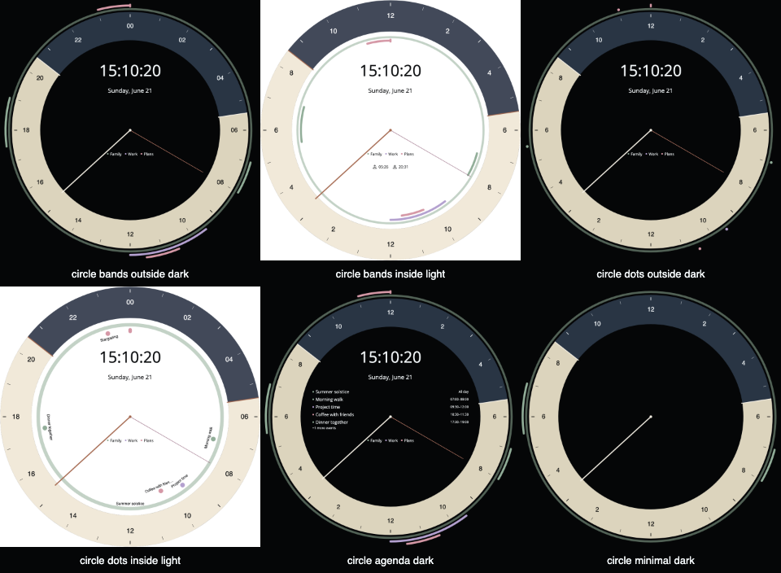

| Demo                                                  | Options                                                                            |
| ----------------------------------------------------- | ---------------------------------------------------------------------------------- |
| [Bands outside · dark](circle-bands-outside-dark.png) | Duration arcs, overlapping lanes, full-day ring, calendar legend, 24-hour labels   |
| [Bands inside · light](circle-bands-inside-light.png) | Inner event lanes, repeated 12-hour labels, sunrise/sunset times, legend           |
| [Dots outside · dark](circle-dots-outside-dark.png)   | Start-time dots, full-day ring, repeated 12-hour labels, legend                    |
| [Dots inside · light](circle-dots-inside-light.png)   | Inner dots, optional abbreviated event names on marks, legend                      |
| [Agenda · dark](circle-agenda-dark.png)               | Duration arcs, optional daily event list, repeated 12-hour labels                  |
| [Minimal · dark](circle-minimal-dark.png)             | Only Family calendar, no digital time/date/legend/seconds, repeated 12-hour labels |

## Rectangular overview

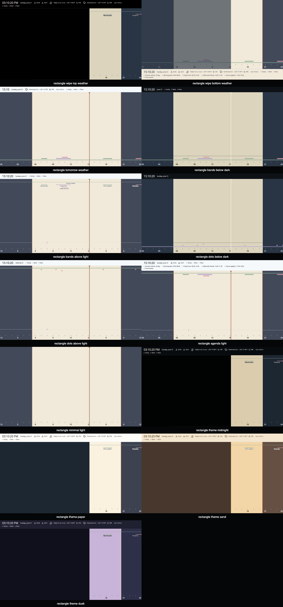

| Demo                                                                         | Options                                                                                                                                    |
| ---------------------------------------------------------------------------- | ------------------------------------------------------------------------------------------------------------------------------------------ |
| [Solid wipe · top bar + weather](rectangle-wipe-top-weather.png)             | Blackout at 100%, custom black bar/cream text, 12-hour digital clock, both markers hidden, today/tomorrow forecast, solar times and legend |
| [Translucent wipe · bottom bar + weather](rectangle-wipe-bottom-weather.png) | Custom wipe at 65%, both markers hidden, today/tomorrow forecast and agenda                                                                |
| [Tomorrow-only weather](rectangle-tomorrow-weather.png)                      | Top bar with only tomorrow's forecast, vertical time marker retained                                                                       |
| [Rectangle settings](rectangle-settings.png)                                 | Bar selector, independent weather toggles, units, wipe color/opacity and marker toggles                                                    |
| [Bands below · dark](rectangle-bands-below-dark.png)                         | Duration segments, overlap lanes, all-day line, calendar legend                                                                            |
| [Bands above · light](rectangle-bands-above-light.png)                       | Optional names on event segments, repeated 12-hour labels                                                                                  |
| [Dots below · dark](rectangle-dots-below-dark.png)                           | Single event-color override, no legend                                                                                                     |
| [Dots above · light](rectangle-dots-above-light.png)                         | Calendar colors, ISO date, repeated 12-hour labels                                                                                         |
| [Agenda · light](rectangle-agenda-light.png)                                 | Optional daily list, sunrise/sunset times, event bands above                                                                               |
| [Minimal · light](rectangle-minimal-light.png)                               | Pure edge-to-edge daylight clock; events/time/date/legend/seconds hidden                                                                   |

## Rectangle starter themes

Each preset below was applied with the actual settings button, copied to a kiosk URL, and loaded before capture. The top bar uses the preset's background/text colors. All examples show both weather days, 12-hour digital time, and elapsed-time wiping without markers; wipe opacity stays at 100% when applying presets.

### Midnight — dark charcoal & warm cream

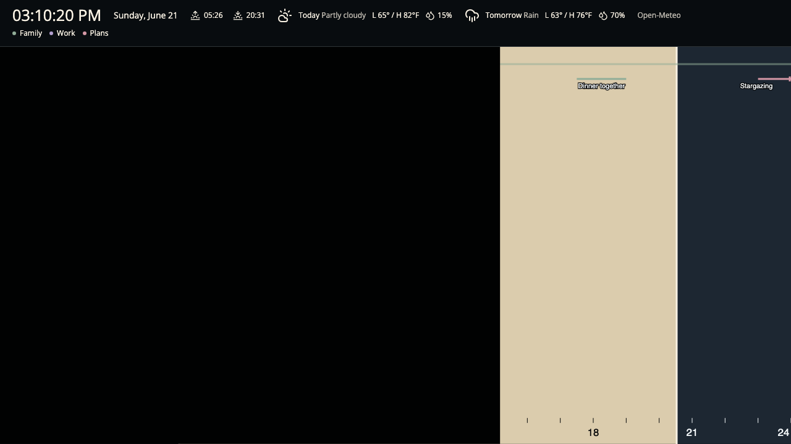

### Paper — bright ivory & slate

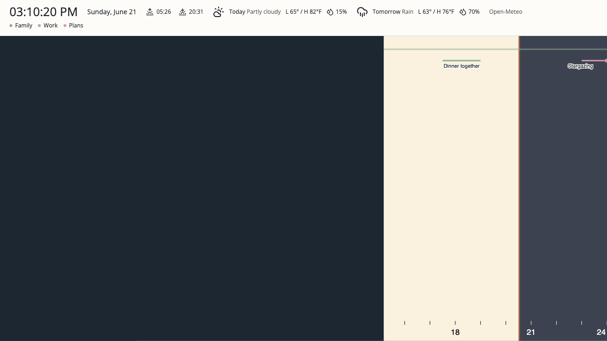

### Sand — soft warm neutrals

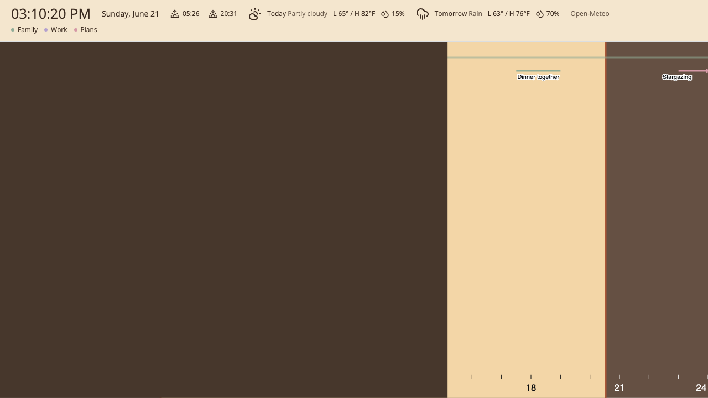

### Dusk — muted plum & lavender

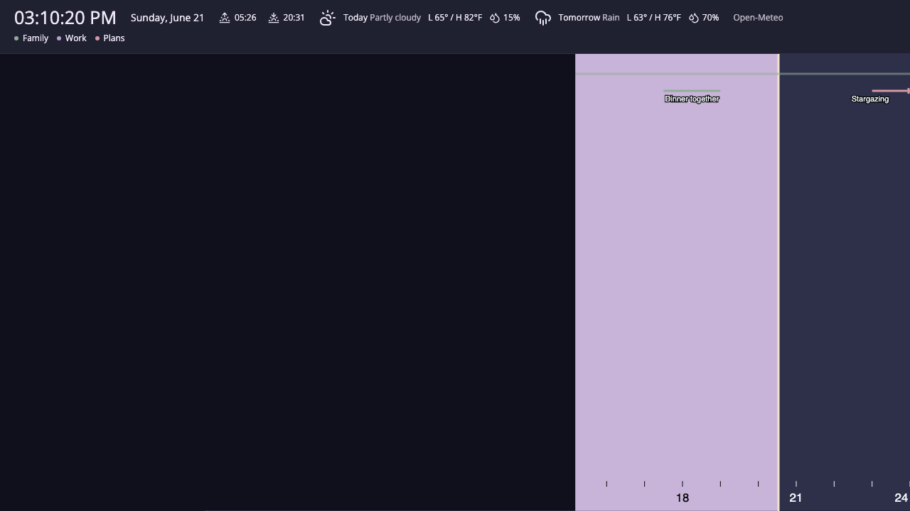

## New rectangle features

### Top bar with today/tomorrow weather and solid blackout

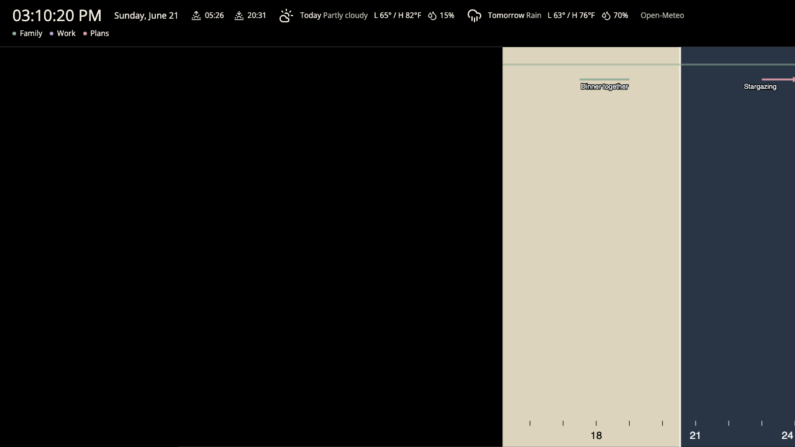

### Bottom bar with today/tomorrow weather, agenda and translucent wipe

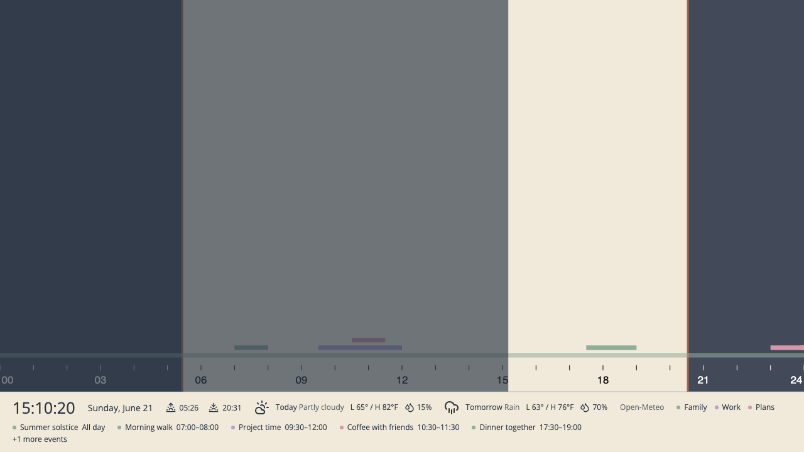

### Tomorrow-only forecast

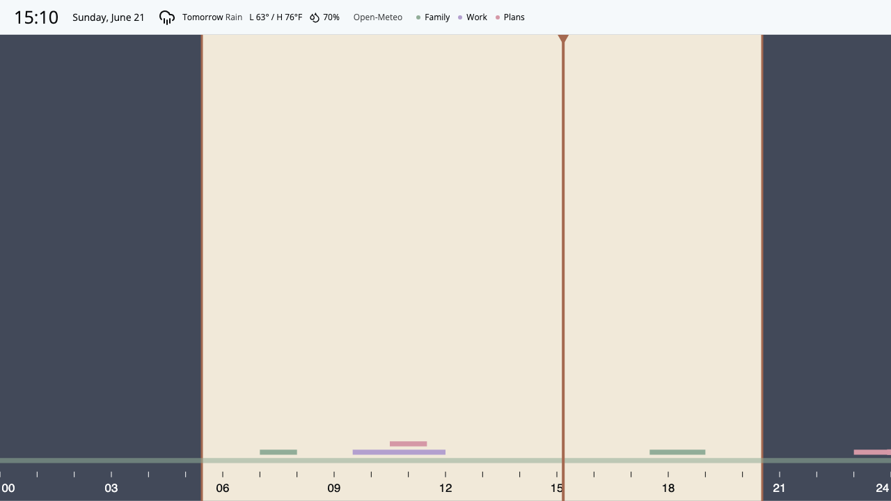

### Settings

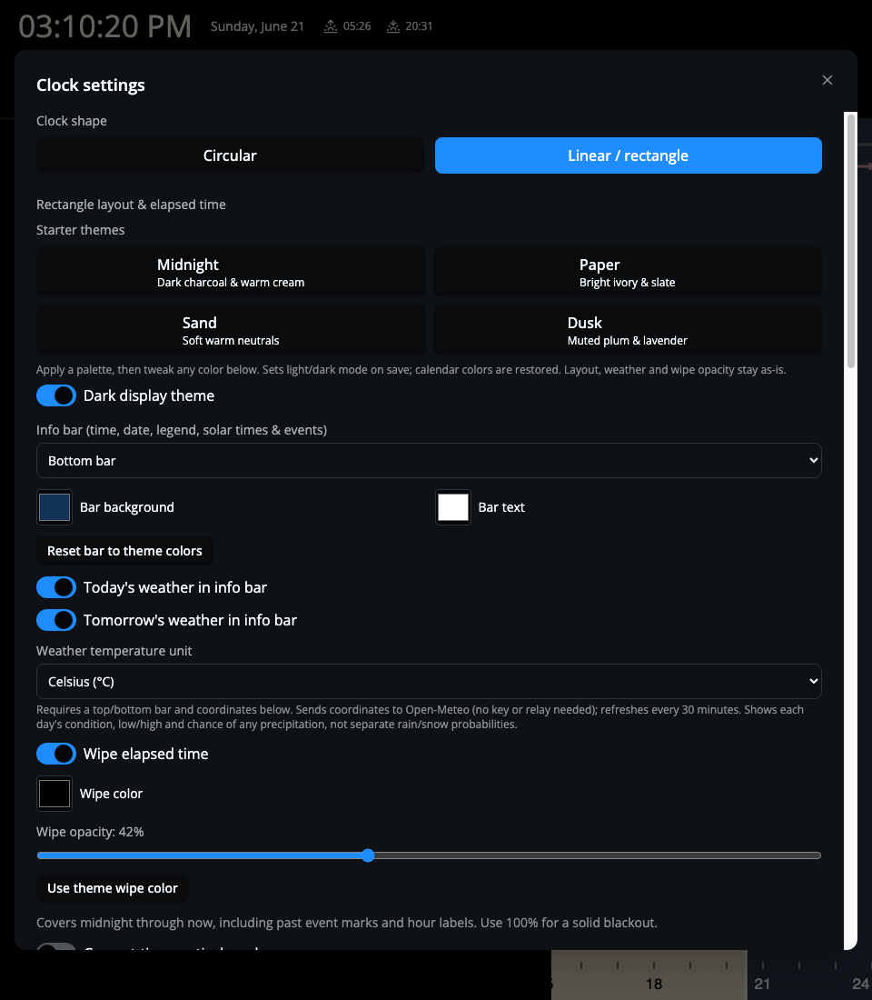

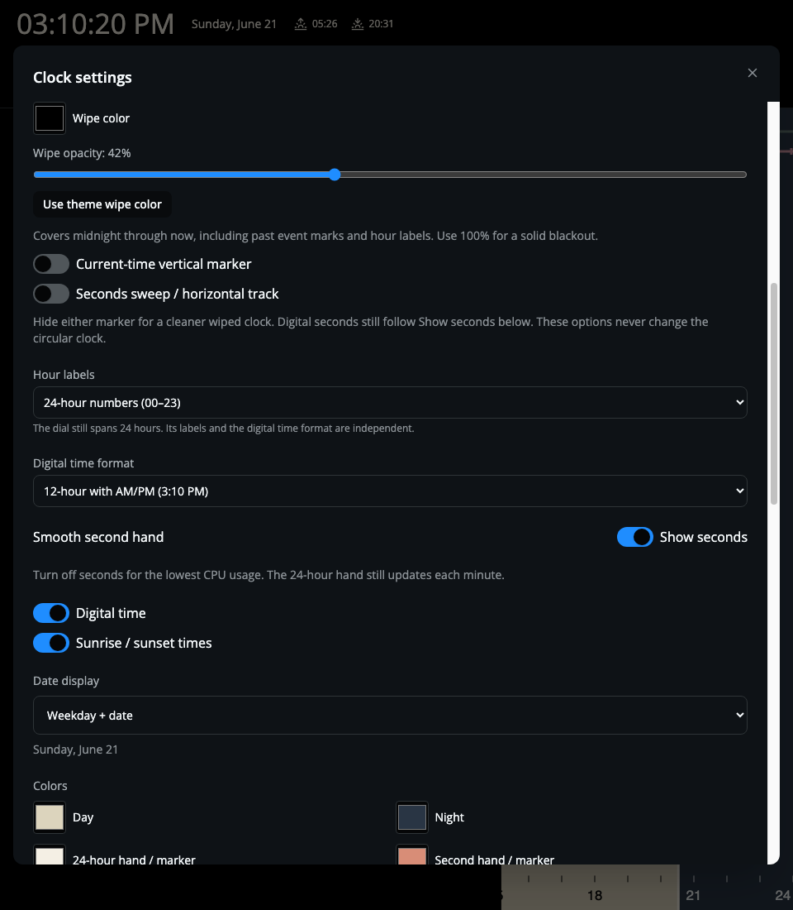

## Full-size examples

### Duration bands, outside

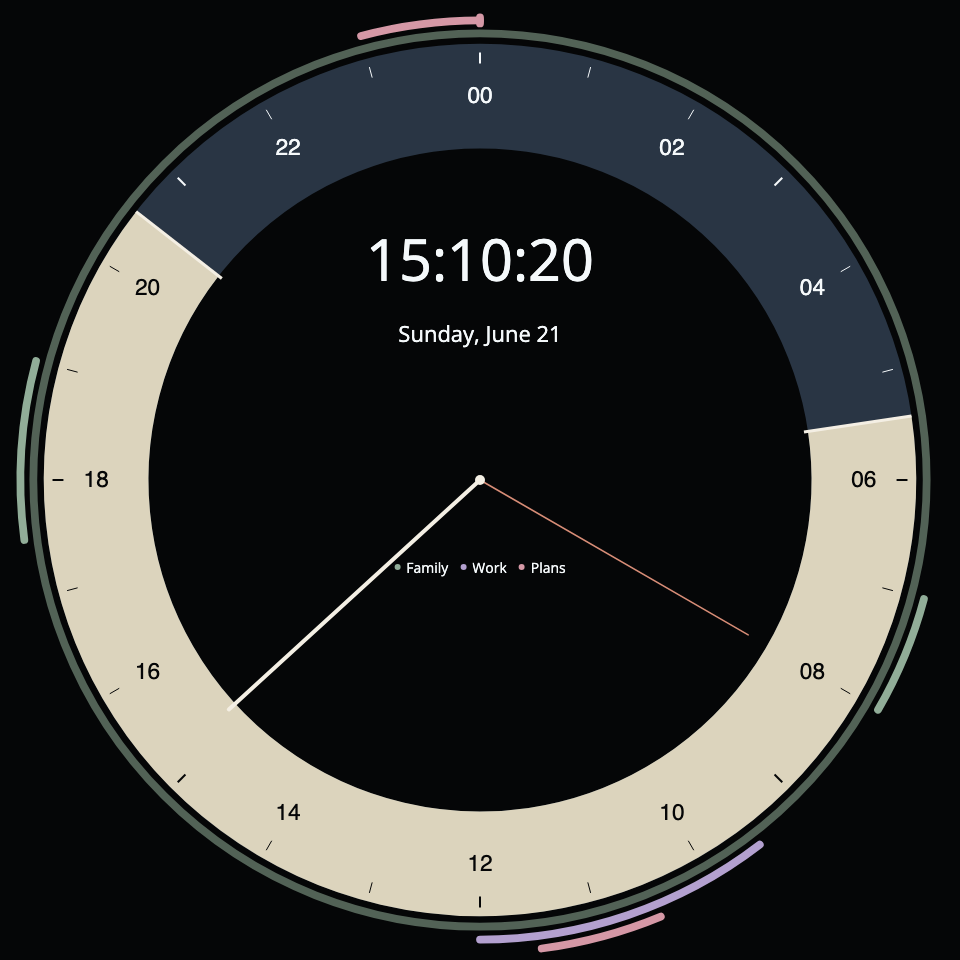

### Start-time dots, outside

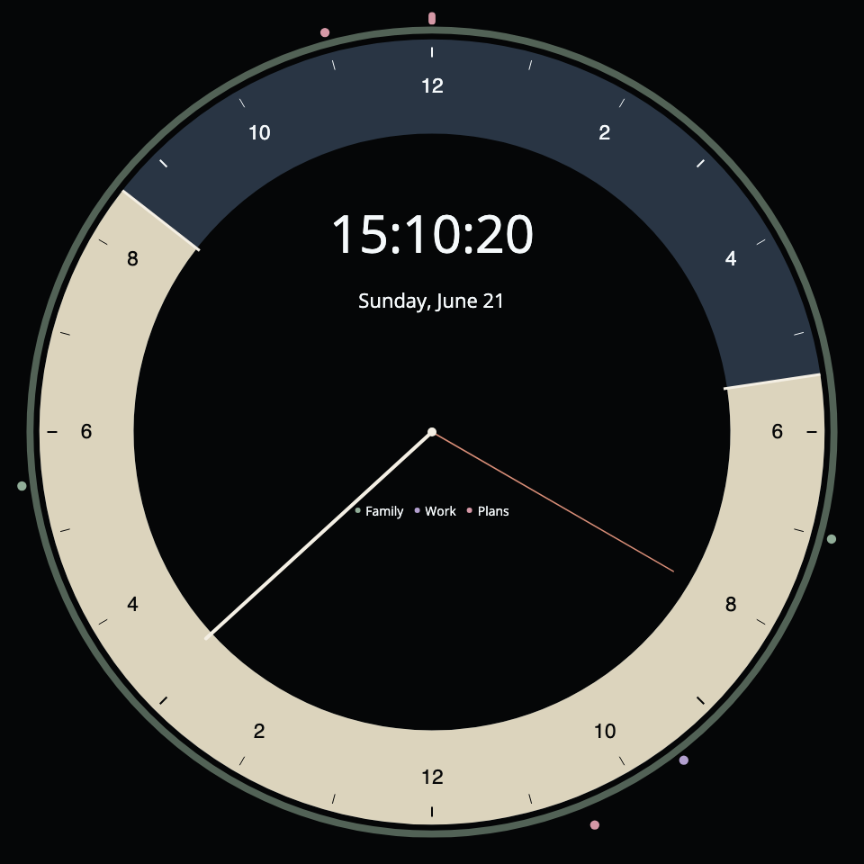

### Duration bands, below

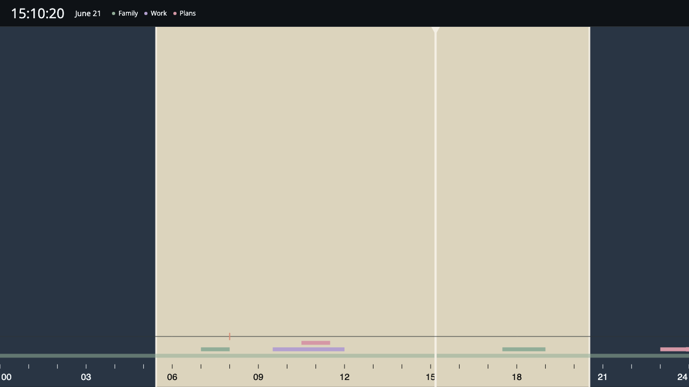

### Start-time dots, above

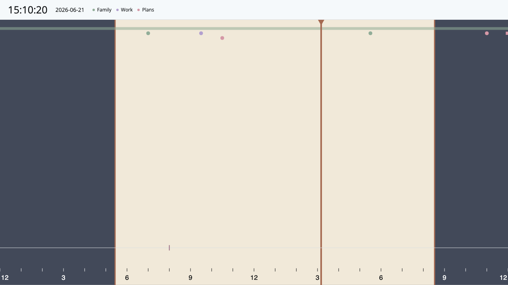

## Demo data and reproducing

- [`demo-feed.json`](demo-feed.json): fictional all-day holiday, morning walk, overlapping work/coffee, dinner, and overnight stargazing events.
- [`demo-options.json`](demo-options.json): complete URL parameter values for every screenshot, including theme, colors, 12/24-hour labels, calendar filtering, names/list/legend, and placement. Its read key is explicitly fictional. These demo feed URLs are not live production links.
- [`../scripts/capture-demos.mjs`](../scripts/capture-demos.mjs): reproducible capture plus browser smoke assertions. Intercepts the demo relay and Open-Meteo endpoints and fixes the browser timezone/date; no Google sign-in needed. Weather examples show fictional partly cloudy/rain forecasts and low/high/precipitation chance.

Build the app, start preview, and start a dedicated headless Chromium with remote debugging:

```bash
pnpm --filter clock build
pnpm --filter clock preview --host 127.0.0.1 --port 5284
# In another terminal (use your platform's Chromium/Chrome binary):
chromium --headless --remote-debugging-port=9224 --user-data-dir=/tmp/clock-demo-chrome --no-first-run about:blank
# Then:
pnpm --filter clock screenshots
```

On macOS the browser binary may be `/Applications/Google Chrome.app/Contents/MacOS/Google Chrome`. Optional environment variables `CLOCK_CDP_URL` and `CLOCK_PREVIEW_URL` select alternate debug/preview endpoints. Use a throwaway browser profile and keep remote debugging bound to localhost.

The capture checks calendar retrieval/legend, URL-driven theme, hidden controls, optional agenda, today/tomorrow weather, wipe pixel alpha/bounds, all-calendars-off behavior, and uncaught browser exceptions. It also opens the actual settings form, changes the bar/unit/opacity without saving, clicks **Copy display URL**, and verifies every setting in the generated link. Every preset is also clicked, copied, checked for seven explicit color values and its light/dark mode, and loaded for a dedicated screenshot. It does not test the Orange Pi's hardware renderer or a real Google account.
